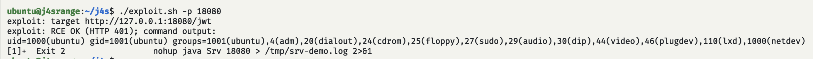
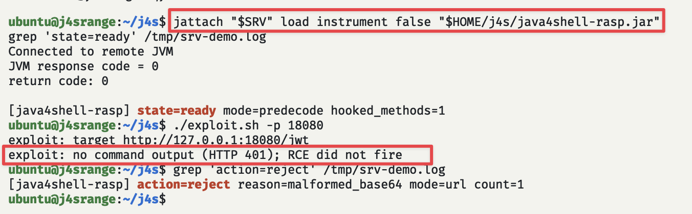

# CloudRASP · Java4Shell Base64 Protection

[简体中文](README_ZH.md)

An offline Java RASP agent that mitigates Java4Shell by rejecting malformed Base64 padding at the `java.util.Base64.Decoder.decode0` entry point before intrinsic decoding runs. Matching inputs throw `IllegalArgumentException` with the message `base64-java4shell`.

> [!IMPORTANT]
> This agent is a targeted mitigation for specific malformed Base64 inputs, not a substitute for a vendor-patched JDK. Always test in a staging environment before deploying to production.

## Protection Effect

Comparison of running the same exploit (`./exploit.sh -p 18080`) against a vulnerable service before and after attaching the RASP agent:

### 1. Without RASP — RCE succeeds

The malformed Base64 payload triggers remote code execution (`uid=1000(ubuntu)...`) and terminates the target JVM process:



### 2. With RASP attached — RCE blocked without restart

After hot-attaching the agent to the running JVM with `jattach` (`state=ready`), the exploit is intercepted at the decoder entry point (`RCE did not fire`), the service stays online, and the blocked attempt is recorded in stderr (`action=reject`):



## How It Works (Aligned with Upstream OpenJDK Fix)

The agent's check directly mirrors the upstream OpenJDK fix semantics at the Java layer, blocking the vulnerable boundary input before it reaches the native intrinsic while preserving full `decodeBlock` SIMD acceleration for valid inputs:

- **Upstream OpenJDK fix ([`5177a70b385c16f26ede191fdac7aaba0bed0f8b`](https://github.com/openjdk/jdk/commit/5177a70b385c16f26ede191fdac7aaba0bed0f8b))**: Adds `cmpl(length, 4)` and `jcc(Assembler::less, L_bruteForce)` at the `L_finalBit` entry point of the Base64 intrinsic stub — when fewer than 4 bytes remain, execution skips `L_finalBit` and immediately falls back to the Java layer so `decode0` throws an exception.
- **CloudRASP equivalent check**: Hooks the entry of `java.util.Base64.Decoder.decode0` (prior to invoking the `decodeBlock` intrinsic) and rejects exactly the affected tail shape — the input is at least 65 bytes, the remainder after 64-byte blocks (`(end - start) & 63`) is 1–3 bytes, and the last byte is `'='`. MIME decoders are passed through because they never enter the affected intrinsic tail. Matching inputs throw `IllegalArgumentException("base64-java4shell")` before the intrinsic runs.

## Deployment

Download the **standalone agent JAR** from [GitHub Releases](https://github.com/boundaryx/cloudrasp-java4shell/releases) or [build it from source](#build-and-compatibility). The public repository contains the protection source code and build instructions only. The examples below assume the standalone JAR is installed at `/opt/rasp/java4shell-rasp.jar`.

### Option 1: Running service — hot-attach without restart (Recommended)

Run [jattach](https://github.com/apangin/jattach) under the target service's OS account. Set `PID` to the target JVM process ID and pass the absolute path to the **standalone** agent JAR as seen by that JVM (use the path inside the container when containerized):

```sh
jattach "$PID" load instrument false /opt/rasp/java4shell-rasp.jar
```

Verify that `[java4shell-rasp] state=ready mode=predecode hooked_methods=1` appears in the target JVM's `stderr`. Installation performs a silent self-test with a known malformed input and reports ready only when the guard intercepts it; the probe is not logged as an attack. Protection takes effect immediately for subsequent decode calls and does not persist across JVM restarts. Dynamic attach must be enabled and the JVM must have a writable temporary directory; if attach is disabled, use one of the restart options below.

### Option 2: Planned restart — disable the Base64 intrinsic (Agentless)

Check the target Java binary first with `java -XX:+PrintFlagsFinal -version`. **Only if `UseBASE64Intrinsics` is present**, add the flag **before** `-jar` in the startup command (the tested JDK 8 build does not have this flag — do not pass it there):

```sh
java -XX:-UseBASE64Intrinsics -jar app.jar
```

After restart, confirm the flag is disabled:

```sh
jcmd "$PID" VM.flags -all | grep UseBASE64Intrinsics
```

The value should be `false` (if `jcmd`/attach is disabled, add `-XX:+PrintFlagsFinal` at startup and verify from stdout). Disabling the intrinsic requires no agent JAR and produces no RASP exceptions or logs, though it may reduce Base64 throughput.

### Option 3: Planned restart — load RASP at startup (`-javaagent`)

To persist RASP protection and rejection logging across restarts, add `-javaagent` **before** `-jar`:

```sh
java -javaagent:/opt/rasp/java4shell-rasp.jar -jar app.jar
```

If hook installation fails during startup, the agent logs `state=refused` and halts the JVM with exit code `78`. A live-attach failure is also logged as `state=refused` and rethrown, so `jattach` reports a nonzero response instead of a false success.

## Runtime Logs

The agent writes structured events to the target JVM's `stderr`:

| Event | Example Output | Description |
| --- | --- | --- |
| Installed | `[java4shell-rasp] state=ready mode=predecode hooked_methods=1` | Hook is active on `Base64.Decoder.decode0`; the real matched-method count is reported after a silent self-test passes. |
| Blocked | `[java4shell-rasp] action=reject reason=malformed_base64 mode=url count=1` | Java4Shell-shaped padding rejected (`mode` is `basic` or `url`; MIME input is passed through). Logged for the first 8 hits and powers of two (`16, 32, 64, ...`) to avoid log flooding. |
| Refused | `[java4shell-rasp] state=refused <error>` | Hook installation or its self-test failed. Startup (`-javaagent`) exits with code `78`; live attach rethrows the failure to `jattach`. |

## Build and Compatibility

Build with JDK 8 or later (both artifacts target Java 8 bytecode):

```sh
mvn clean package
```

- `target/java4shell-rasp-1.1.0-agent.jar` — Standalone shaded agent JAR for `jattach` or `-javaagent` deployment.
- `target/java4shell-rasp.jar` — Unshaded library JAR for embedding in an existing host agent via `DecoderHook.install(instrumentation)`.

**Compatibility & Scope:**

- Verified for both startup (`-javaagent`) and live attach (`jattach`) on HotSpot **8, 11, 17, 21, and 25**, with the full regression suite executed on **17, 21, and 25** (the JDK 25 install used for verification is a JRE, so `javac`/`javap`/`jcmd` came from JDK 21).
- Requires JVM class retransformation support and a compatible `java.util.Base64.Decoder.decode0` implementation.
- Runtime compatibility does not imply that a given JDK build is vulnerable.
- Streaming Base64 decoders and third-party Base64 libraries are out of scope.
