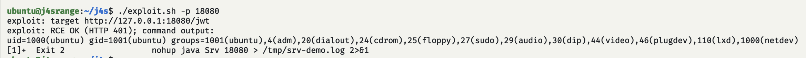
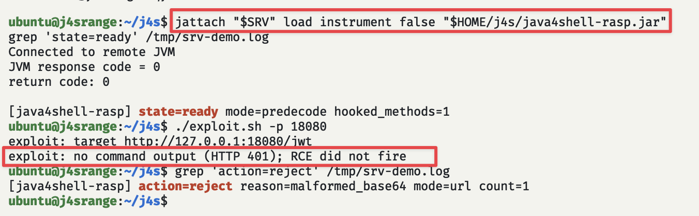

# CloudRASP · Java4Shell Base64 防护

[English](README.md)

这是一个可离线运行的 Java RASP 探针，通过在 `java.util.Base64.Decoder.decode0` 解码入口处（进入底层 intrinsic 解码前）拦截特定的畸形 Base64 填充输入来缓解 Java4Shell 漏洞。命中规则时直接抛出消息为 `base64-java4shell` 的 `IllegalArgumentException`。

> [!IMPORTANT]
> 该探针是针对特定畸形 Base64 输入的定向缓解措施，不能替代厂商修复版 JDK。部署到生产环境前请务必先在测试环境充分验证。

## 防护效果对比

以下为针对存在漏洞的目标服务执行同一漏洞利用脚本（`./exploit.sh -p 18080`）在安装 RASP 前后的实测对比：

### 1. 未安装 RASP：正常触发 RCE

畸形 Base64 载荷成功触发远程命令执行并返回 `uid=1000(ubuntu)...`，同时导致目标 JVM 进程异常退出：



### 2. 安装 RASP 后：RCE 失败，攻击被实时拦截

通过 `jattach` 免重启将探针动态挂载到运行中的 JVM（确认 `state=ready`）后再次执行利用脚本，恶意载荷在解码入口被直接拦截（`RCE did not fire`），业务进程保持存活，并在标准错误日志中记录 `action=reject` 拦截事件：



## 实现原理（复刻官方修复对照）

本探针的拦截逻辑直接对标 OpenJDK 官方修复语义，在不关闭底层 SIMD 硬件加速（保留合法输入的 `decodeBlock` intrinsic 性能）的前提下，于 Java 入口阻断触发漏洞的边界输入：

- **OpenJDK 官方修复（[`5177a70b385c16f26ede191fdac7aaba0bed0f8b`](https://github.com/openjdk/jdk/commit/5177a70b385c16f26ede191fdac7aaba0bed0f8b)）**：在底层 Base64 intrinsic 汇编生成的 `L_finalBit` 入口处新增 `cmpl(length, 4)` 与 `jcc(Assembler::less, L_bruteForce)` 检查——当尾部剩余不足 4 字节时，不再进入存在缺陷的 `L_finalBit` 分支，而是直接跳转回退至 Java 层交由 `decode0` 抛出异常。
- **CloudRASP 等价复刻**：在 `java.util.Base64.Decoder.decode0` 方法入口（调用底层 `decodeBlock` intrinsic 之前）前置检查精确的受影响尾部形态——输入长度至少 65 字节，按 64 字节块切分后的余数（`(end - start) & 63`）为 1–3 字节，且最后一个字节为填充符 `=`。MIME 解码器不会进入受影响的 intrinsic 尾部，因此直接放行。命中时在 intrinsic 执行前抛出 `IllegalArgumentException("base64-java4shell")`。

## 安装与部署

从 [GitHub Releases](https://github.com/boundaryx/cloudrasp-java4shell/releases) 下载**独立 agent JAR**，或参考下文[自行从源码编译](#源码编译与兼容性)。公开仓库仅包含防护源码与构建说明。以下示例假设独立 JAR 已部署至 `/opt/rasp/java4shell-rasp.jar`。

### 方案一：运行中的服务 —— 使用 jattach 免重启安装（推荐）

使用目标业务进程所属的系统账号运行 [jattach](https://github.com/apangin/jattach)。将 `PID` 设为目标 JVM 进程号，并传入目标 JVM 视角下**独立 agent JAR** 的绝对路径（容器环境请使用容器内路径）：

```sh
jattach "$PID" load instrument false /opt/rasp/java4shell-rasp.jar
```

检查目标 JVM 标准错误日志（`stderr`），出现 `[java4shell-rasp] state=ready mode=predecode hooked_methods=1` 即代表安装成功。安装过程会用已知畸形输入做一次静默自检，只有守卫确实拦截成功才会报告 `state=ready`，自检不会记为攻击事件。防护对后续解码调用立即生效，但**重启后不保留**。目标 JVM 需允许动态加载 agent 且临时目录可写；若环境禁止 attach，请采用以下重启方案。

### 方案二：计划内重启 —— 禁用 Base64 intrinsic（无需探针）

先使用业务实际运行的 Java 执行 `java -XX:+PrintFlagsFinal -version` 检查开关。**仅当输出中包含 `UseBASE64Intrinsics` 时**，在启动命令的 `-jar` 之前添加以下参数（实测的 JDK 8 无此开关，请勿添加）：

```sh
java -XX:-UseBASE64Intrinsics -jar app.jar
```

重启后执行以下命令核对参数已生效（应显示 `false`）：

```sh
jcmd "$PID" VM.flags -all | grep UseBASE64Intrinsics
```

若环境禁止 attach / `jcmd`，可在启动参数中额外添加 `-XX:+PrintFlagsFinal` 并从启动输出中核对。禁用该优化无需加载 RASP JAR，不会产生 RASP 异常或拦截日志，但可能降低 Base64 吞吐量。

### 方案三：计划内重启 —— 启动时加载 RASP（`-javaagent`）

若希望重启后持续保留 RASP 防护与拦截日志，可在启动命令的 `-jar` 之前挂载探针：

```sh
java -javaagent:/opt/rasp/java4shell-rasp.jar -jar app.jar
```

若启动阶段挂钩安装失败，探针会输出 `state=refused` 并以退出码 `78` 终止 JVM。运行中挂载失败同样会输出 `state=refused` 并向上抛出异常，使 `jattach` 返回非零响应，而不是伪装成安装成功。

## 运行日志说明

探针向目标 JVM 的标准错误流（`stderr`）输出结构化日志：

| 状态 | 日志示例 | 说明 |
| --- | --- | --- |
| 安装就绪 | `[java4shell-rasp] state=ready mode=predecode hooked_methods=1` | `Base64.Decoder.decode0` 挂钩已生效；`hooked_methods` 为实际匹配的方法数，且仅在静默自检通过后报告。 |
| 攻击拦截 | `[java4shell-rasp] action=reject reason=malformed_base64 mode=url count=1` | 拒绝 Java4Shell 形态的填充输入（`mode` 为 `basic` 或 `url`；MIME 输入直接放行）。为避免日志刷屏，仅在前 8 次及后续 2 的幂次（`16, 32, 64, ...`）采样输出。 |
| 启动拒绝 | `[java4shell-rasp] state=refused <error>` | 挂钩安装或安装自检失败。`-javaagent` 启动时以状态码 `78` 退出；运行中挂载时向 `jattach` 抛出异常。 |

## 源码编译与兼容性

使用 JDK 8 或更高版本编译（所有产物均以 Java 8 字节码为目标）：

```sh
mvn clean package
```

- `target/java4shell-rasp-1.1.0-agent.jar`：独立打包的 agent JAR，用于 `jattach` 免重启挂载或 `-javaagent` 启动加载。
- `target/java4shell-rasp.jar`：不含第三方依赖的精简库，供宿主 agent 通过 `DecoderHook.install(instrumentation)` 集成。

**兼容性与防护边界：**

- 已在 HotSpot **8、11、17、21、25** 验证启动加载与免重启挂载，并在 **17、21、25** 完成完整回归测试（验证所用 JDK 25 为 JRE，`javac`/`javap`/`jcmd` 取自 JDK 21）。
- 要求目标 JVM 支持类重转换（Retransform），且 `java.util.Base64.Decoder.decode0` 方法签名与实现结构匹配。
- 探针可运行不代表当前 JDK 版本存在漏洞。
- 流式 Base64 解码接口及第三方 Base64 实现不在本探针防护范围内。
